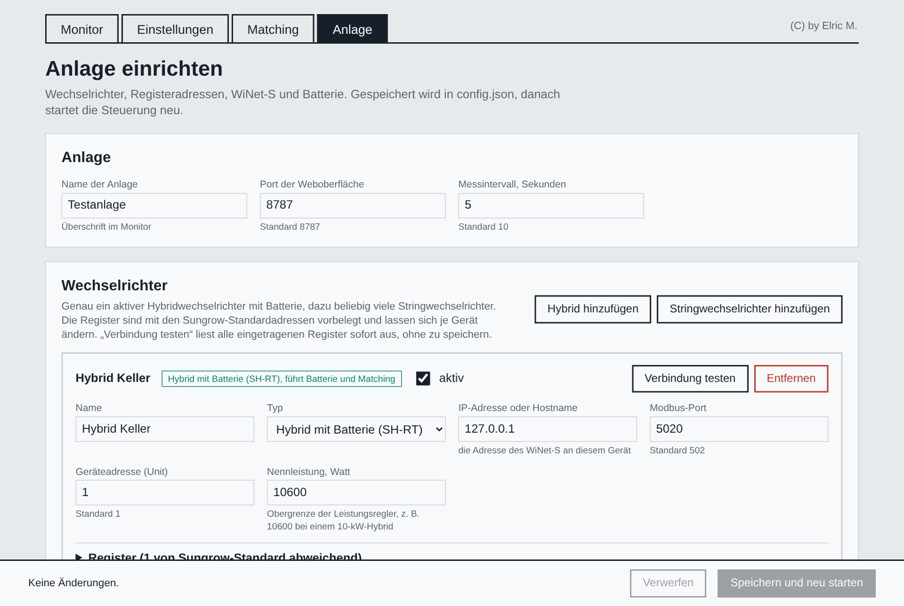
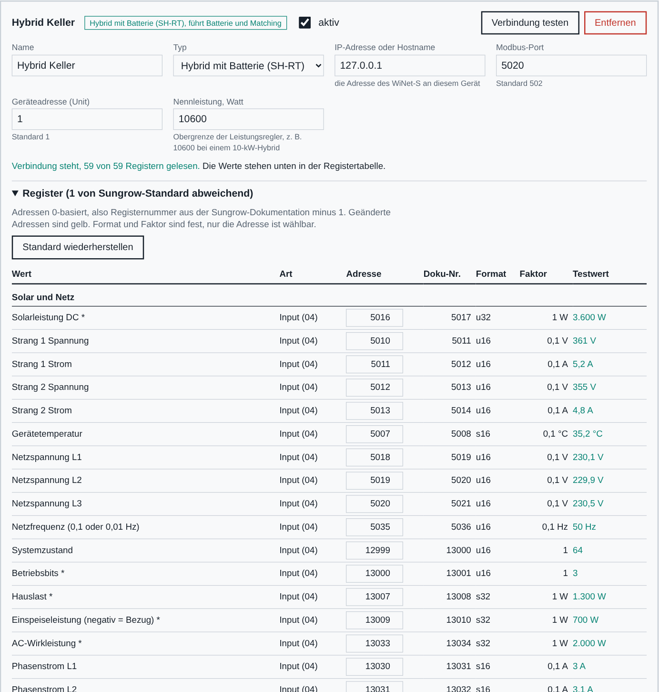
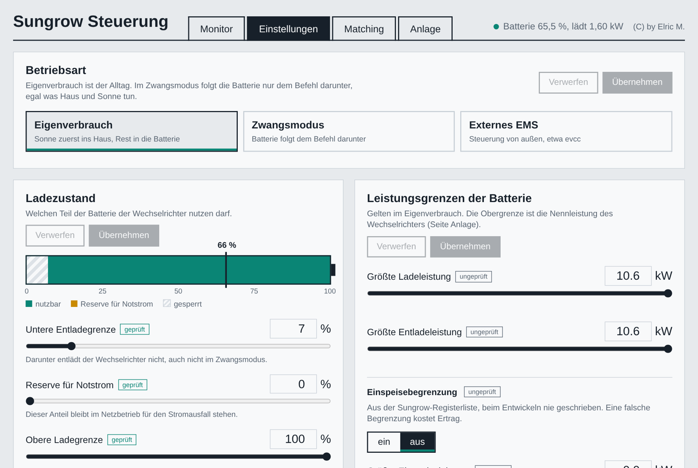
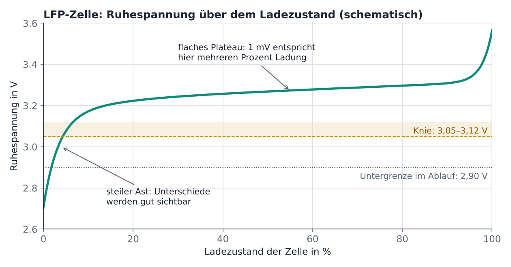
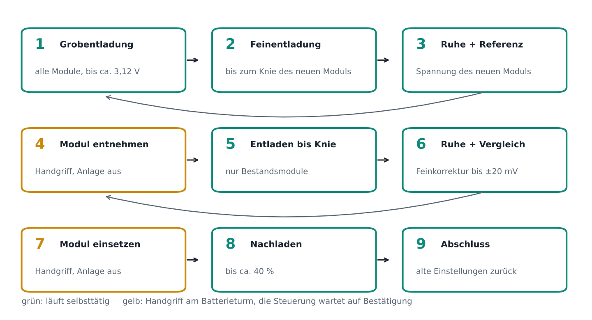

# Sungrow Steuerung – Handbuch

(C) by Elric M. · Nur private Nutzung zu Test- und Lernzwecken · Benutzung auf eigene Gefahr

---

## 1. Überblick

Die Sungrow Steuerung ist eine kleine Weboberfläche für Photovoltaikanlagen mit einem
Sungrow-Hybridwechselrichter der SH-RT-Reihe und einem Batterieturm (SBR). Sie spricht direkt mit den
Geräten im Heimnetz – per Modbus TCP und über die Weboberfläche des WiNet-S – und braucht weder Cloud
noch zusätzliche Software außer Node.js.

Sie besteht aus vier Seiten:

| Seite | Adresse | Zweck |
|---|---|---|
| Monitor | `/` | Leistungsfluss, Zellspannungen, Verlauf, Energie, Balancing-Protokoll |
| Einstellungen | `/einstellungen` | Einstellungen des Hybridwechselrichters lesen und schreiben |
| Matching | `/matching` | Assistent zum Angleichen eines neuen Batteriemoduls |
| Anlage | `/anlage` | Einrichtung: Wechselrichter, Register, WiNet-S, Batterieturm (mit Passwort) |

> **Sicherheit.** Monitor, Einstellungen und Matching haben keinen Passwortschutz. Die Steuerung gehört
> ins eigene Heimnetz. Wer sie von unterwegs nutzen will, sollte ein VPN verwenden und sie nicht offen ins
> Internet stellen.

Die Installation beschreibt [INSTALL.md](INSTALL.md).

---

## 2. Seite Anlage – Einrichtung

### 2.1 Zugang

Beim ersten Aufruf legt man ein Passwort fest (mindestens 8 Zeichen). Gespeichert wird nur ein
scrypt-Hash in `config.json`. Die Anmeldung gilt 12 Stunden und übersteht einen Neustart. Nach fünf
Fehlversuchen sperrt die Seite für kurze Zeit. Unten auf der Seite lässt sich das Passwort ändern.

Solange kein Hybridwechselrichter eingetragen ist, läuft die Steuerung im **Einrichtungsmodus**: alle
anderen Seiten leiten auf `/anlage` um.

### 2.2 Anlage

- **Name der Anlage** – Überschrift im Monitor.
- **Port der Weboberfläche** – Standard 8787. Nach einer Änderung leitet die Seite selbst auf den neuen
  Port weiter.
- **Messintervall** – wie oft die Wechselrichter abgefragt werden, Standard 10 Sekunden.

### 2.3 Wechselrichter

Es gibt **genau einen aktiven Hybridwechselrichter**. Er liefert Batterie, Hausverbrauch und Netzbezug
und ist das Gerät, auf das Einstellungen und Matching schreiben. Dazu können **beliebig viele
Stringwechselrichter** kommen, deren Leistung im Monitor als „Solar gesamt“ mitgezählt wird.

Je Gerät:

| Feld | Bedeutung |
|---|---|
| Name | frei wählbar, erscheint im Monitor |
| Typ | Hybrid mit Batterie (SH-RT) oder Stringwechselrichter (SG-RT) |
| aktiv | ausgeschaltete Geräte bleiben gespeichert, werden aber nicht abgefragt |
| IP-Adresse oder Hostname | Adresse des WiNet-S bzw. des Wechselrichters |
| Modbus-Port | Standard 502 |
| Geräteadresse (Unit) | Standard 1 |
| Nennleistung (Hybrid) | Obergrenze aller Leistungsregler in Watt, z. B. 10600 bei einem 10-kW-Gerät |
| Hausverbrauch addieren (String) | nötig, wenn der Stringwechselrichter hinter dem Zähler des Hybrids einspeist und sein Ertrag sonst im Hausverbrauch fehlt |

**„Verbindung testen“** liest sofort alle eingetragenen Register und zeigt die Werte in der Tabelle –
ohne zu speichern. So sieht man vor dem Speichern, ob Adresse, Unit und Registerkarte stimmen.

### 2.4 Registeradressen

Unter **„Register“** klappt die Tabelle aller benutzten Register auf. Jede Zeile zeigt

- die **Adresse** (0-basiert, so wie sie im Modbus-Telegramm steht),
- die **Doku-Nr.** (Registernummer aus der Sungrow-Dokumentation = Adresse + 1),
- Funktionscode (FC03 Holding, FC04 Input), Datentyp, Einheit,
- nach einem Test den **gelesenen Wert**.

Die Adressen sind mit den Sungrow-Standardwerten vorbelegt. Weicht eine Firmware ab, trägt man die
richtige Adresse ein; „Standard wiederherstellen“ setzt sie zurück. Gespeichert werden nur die
Abweichungen. Die Steuerung fasst benachbarte Register beim Lesen zu Blöcken zusammen; kennt der
Wechselrichter einen Block nicht (Modbus-Ausnahme 2 oder 3), liest sie diesen Block danach einzeln.

Wichtige Standardadressen des Hybrids (Input-Register, FC04):

| Wert | Adresse | Typ |
|---|---|---|
| PV-Leistung | 5016 | u32, W |
| Hausverbrauch | 13007 | s32, W |
| Netzleistung (Einspeisung positiv) | 13009 | s32, W |
| Batteriespannung | 13019 | 0,1 V |
| Batteriestrom / -leistung | 13020 / 13021 | |
| Ladezustand (SoC) | 13022 | 0,1 % |
| Betriebszustand | 12999 / 13000 | |

Einstellungen (Holding-Register, FC03/FC06): Betriebsart 13049, Befehl 13050, Leistung 13051,
obere/untere Ladegrenze 13057/13058, Notstromreserve 13099, Einspeisebegrenzung 13086/13073,
größte Lade-/Entladeleistung 33046/33047, Zeitfenster 33207–33218.

Für Stringwechselrichter: AC-Leistung 5030 (u32), DC-Leistung 5016, Tagesertrag 5002, Gesamtertrag 5003.

> **Vorsicht.** Eine falsche Adresse bei den Holding-Registern bedeutet, dass beim Schreiben ein
> anderes Register verändert wird. Adressen der Einstellungen nur ändern, wenn die richtige Adresse
> sicher aus der Dokumentation der eigenen Firmware stammt.

### 2.5 Zellwerte

Die Spannungen der einzelnen Zellen kommen nicht über Modbus TCP des Hybrids, sondern über die
Weboberfläche des WiNet-S. Dafür braucht die Steuerung Benutzer und Passwort dieser Oberfläche.
Das Passwort wird nie an den Browser zurückgegeben; ein leeres Feld beim Speichern behält das gespeicherte.

Quellen:

- **WiNet-S** (empfohlen) – Anmeldung per WebSocket, Zellblock ab Register 10756.
- **Modbus** – für Anlagen, bei denen die Batterie selbst per Modbus erreichbar ist (eigene Unit, Standard 200).
- **aus** – keine Zellwerte; der Monitor zeigt dann nur die Gesamtbatterie.

Der WiNet-S lässt nur **eine** Admin-Sitzung zu. Muss man selbst in die WiNet-Oberfläche, gibt der Knopf
**„WiNet-S freigeben“** im Monitor ihn für eine wählbare Zeit frei. Während eines Matching-Ablaufs ist
das gesperrt, weil der Ablauf die Zellwerte braucht.

### 2.6 Batterieturm

- **Anzahl Module** (1–8) und **Nummer des obersten Moduls** – bestimmt die Reihenfolge im Monitor.
- **Zielmodul** – das neue Modul, das der Matching-Assistent angleichen soll.
- **Notizen je Modul** – kurze Bemerkung, z. B. „neu“, erscheint im Monitor unter der Modulnummer.

### 2.7 Speichern

**„Speichern und neu starten“** prüft alle Eingaben, schreibt `config.json` (die vorige Fassung bleibt als
`config.json.bak`) und startet die Steuerung neu. Läuft sie unter systemd oder einem anderen Dienstverwalter
(`SUNGROW_SUPERVISED=1`), beendet sie sich und lässt sich von dort neu starten; sonst startet sie sich
selbst. Während eines Matching-Ablaufs ist Speichern gesperrt.

---

## 3. Monitor

- **Kopfzeile** – Betriebszustand und Betriebsart, Zeit der letzten Messung, Knopf „WiNet-S freigeben“.
- **Batterieturm** – Ladezustand, Spannung, Strom, Leistung, Temperatur. Darunter jedes Modul mit
  niedrigster und höchster Zellspannung und seiner Spreizung. Unten die **Spreizung über alle Zellen**.
- **Leistungsfluss** – Solar gesamt (Hybrid plus alle aktiven Stringwechselrichter), Batterie, Netz, Haus.
- **Module im Vergleich** – Zellspannung je Modul und Abstand jedes Moduls zum Median des Turms.
- **Verlauf** – Leistung, Ladezustand und Spreizung der letzten Tage.
- **Energie** – Tageswerte für PV je Wechselrichter, Batterie, Netz und Eigenverbrauch.
- **Balancing-Protokoll** – je Tag die Spreizung bei vollem und bei leerem Speicher. So lässt sich über
  Wochen verfolgen, ob ein Modul aufholt.

---

## 4. Einstellungen

Die Seite liest die Einstellungen des Hybridwechselrichters und schreibt geänderte Werte zurück. Jede
Änderung wird vor dem Schreiben geprüft (Grenzen, Nennleistung), danach zurückgelesen und im Protokoll
festgehalten. Einstellungen mit größerer Wirkung (Betriebsart, Einspeisebegrenzung) verlangen eine
Bestätigung.

Kennzeichnung:

- **geprüft** – beim Entwickeln an einem SH-RT-Gerät geschrieben und das Verhalten beobachtet.
- **ungeprüft** – aus der Sungrow-Registerliste übernommen, nicht praktisch erprobt.

Gruppen: Betriebsart und Zwangsmodus · Lade- und Entladegrenzen · Leistungsgrenzen · Zwangsladung nach
Zeitfenster · Einspeisebegrenzung.

Hinweise oben auf der Seite weisen auf Einstellungen hin, die den Alltag stören oder einen Matching-Ablauf
verhindern würden, z. B. eine hohe untere Entladegrenze.

---

## 5. Matching-Assistent

### 5.1 Wozu

Wird ein neues Modul in einen bestehenden Turm gesetzt, hat es meist einen anderen Ladezustand als die
Bestandsmodule. Das Batteriemanagement gleicht nur passiv und langsam aus (es entlädt die jeweils
höchsten Zellen über Widerstände). Bis dahin begrenzt die schwächste Zelle die Entladung und die
stärkste die Ladung – nutzbare Kapazität geht verloren.

Der Assistent bringt neues Modul und Bestand **am unteren Ende** auf denselben Stand
(Bottom-Matching). Dort ist die LFP-Kennlinie steil, Unterschiede werden in Millivolt gut sichtbar.

### 5.2 Spannungslinienknick

Eine LFP-Zelle hat zwischen etwa 15 und 90 % Ladezustand ein sehr flaches Plateau: ein Millivolt
entspricht dort mehreren Prozent Ladung, Spannungsvergleiche sind kaum aussagekräftig. Unterhalb von
rund 10 % knickt die Kennlinie ab (das „Knie“, etwa 3,05–3,12 V Ruhespannung). Hier unterscheiden sich
Zellen mit unterschiedlichem Ladezustand um zig Millivolt – ein verlässlicher Vergleichspunkt.

Daraus folgt für den Alltag:

- Eine große Spreizung bei fast leerem Speicher ist normal und kein Defekt; aussagekräftig ist der
  Vergleich über mehrere Tage am gleichen Punkt der Kennlinie.
- Mitten im Plateau sagt eine kleine Spreizung wenig über den tatsächlichen Gleichstand.
- Module unterschiedlicher Kapazität (z. B. ein neues Modul mit etwas mehr Amperestunden) laufen am
  oberen und unteren Ende immer etwas auseinander, auch wenn sie perfekt angeglichen sind.

**Praxisbeispiel (anonym).** In einem Turm mit sieben älteren Modulen und einem neu eingesetzten lag die
Spreizung über alle Zellen bei leerem Speicher zunächst bei rund 250 mV, fast vollständig verursacht durch
das neue Modul. Nach dem Matching sank sie in wenigen Tagen deutlich; die Bestandsmodule lagen untereinander
bei 2–5 mV. Die verbleibenden Unterschiede am Knie erklärten sich zum größten Teil durch die etwas höhere
Kapazität des neuen Moduls, nicht durch einen Fehler.

### 5.3 Ablauf

1. **Grobentladung** mit allen Modulen bis kurz vor das Knie.
2. **Feinentladung** mit kleiner Leistung bis zum Knie des neuen Moduls.
3. **Ruhe und Referenzmessung** – die Spannung des neuen Moduls wird gemerkt.
4. **Neues Modul entnehmen** – Handgriff am Turm, Anlage nach Herstellervorgabe ausschalten.
   Die Steuerung wartet auf die Bestätigung.
5. **Grob- und Feinentladung** der Bestandsmodule bis zum Knie.
6. **Ruhe und Vergleich** mit der Referenz. Liegt die niedrigste Zelle nicht innerhalb von ±20 mV,
   folgen kurze Feinkorrekturen (laden oder entladen), jeweils mit Ruhepause.
7. **Neues Modul wieder einsetzen** – Handgriff, Bestätigung.
8. **Gemeinsam nachladen** bis etwa 40 %.
9. **Abschluss** – alle zuvor gemerkten Einstellungen werden zurückgeschrieben.

Während des Ablaufs schaltet die Steuerung den Wechselrichter in den Zwangsmodus und setzt Grenzen, die
eine tiefe Entladung verhindern würden, vorübergehend herab. Jeder Schritt hat ein Zeitlimit; bei
Auffälligkeiten hält der Ablauf an und wartet auf Entscheidung (fortsetzen oder abbrechen). Der Stand wird
in `data/ablauf.json` gesichert und übersteht einen Neustart.

> **Sicherheit.** Entnehmen und Einsetzen von Batteriemodulen nur nach den Vorgaben des Herstellers und
> nur, wenn man dafür qualifiziert ist. Der Ablauf geht bewusst bis in den unteren Ladebereich; die
> Untergrenze liegt bei 2,90 V je Zelle.

---

## 6. Werkzeuge für die Konsole

Alle Werkzeuge lesen Adresse, Port, Geräteadresse und abweichende Registeradressen aus `config.json`.

| Aufruf | Zweck |
|---|---|
| `node check.js [IP]` | liest alles, was eine Entladung verhindern kann; schreibt nichts |
| `node ems.js status` | zeigt Betriebsart und Zwangsmodus |
| `node ems.js laden 3000` / `entladen 3000` / `ruhe` / `normal` | Zwangsmodus von Hand – **schreibt** |
| `node modbus.js lesen 4 13019 6` | beliebige Register lesen (FC03 oder FC04) |
| `node modbus.js schreiben 13058 50` | ein Holding-Register schreiben, mit Rückfrage |

`modbus.js` kennt die Zusätze `--host`, `--port`, `--unit` und `--ja` (ohne Rückfrage).

---

## 7. Schnittstellen (für eigene Auswertungen)

| Endpunkt | Inhalt |
|---|---|
| `GET /api/live` | aktuelle Messwerte, Zellen, Stringwechselrichter, Fehlerzustand |
| `GET /api/history` | Verlauf |
| `GET /api/balancing` | Balancing-Protokoll je Tag |
| `GET /api/settings` | Einstellungen des Hybrids (`?force=1` liest neu) |
| `GET /api/state` | Stand des Matching-Ablaufs |
| `POST /api/winet-pause` | WiNet-S freigeben, `{ "minutes": 30 }`, `0` beendet die Freigabe |
| `/api/setup/*` | Seite Anlage, nur nach Anmeldung |

Jede Antwort trägt die Kopfzeile `X-Build` mit der Kennung des Programmstands.

---

## 8. Dateien

| Datei | Zweck |
|---|---|
| `server.js` | Hauptprogramm: Abfrage, Speicherung, Weboberfläche |
| `registers.js` | Registerkarten für Hybrid und String, Lesepläne |
| `control.js` | Einstellungen und Matching-Ablauf |
| `setup.js` | Seite Anlage: Anmeldung, Prüfung, Speichern |
| `check.js`, `ems.js`, `modbus.js` | Konsolenwerkzeuge |
| `start.sh`, `stop.sh`, `watchdog.sh`, `install-dienst.sh` | Betrieb auf NAS und Linux |
| `public/` | Weboberfläche |
| `config.json` | persönliche Einstellungen – entsteht beim ersten Speichern, **nicht weitergeben** |
| `data/` | Verlauf, Protokolle, Ablaufstand – **nicht weitergeben** |

---

## 9. Fehlersuche

| Meldung | Ursache und Abhilfe |
|---|---|
| Wechselrichter antwortet nicht | IP-Adresse, Port 502, Modbus TCP am WiNet-S aktiv? Kein zweites Programm, das dauerhaft per Modbus abfragt? |
| Modbus-Ausnahme 2 | Registeradresse unbekannt – auf der Seite Anlage die Adresse prüfen (Doku-Nr. minus 1). |
| WiNet-S: Anmeldung abgelehnt | Benutzer/Passwort der WiNet-Weboberfläche prüfen; ist gerade jemand anderes angemeldet? |
| Zellwerte fehlen zeitweise | WiNet-S war freigegeben oder eine andere Sitzung hat ihn übernommen. |
| Seiten leiten auf /anlage um | Einrichtungsmodus: noch kein aktiver Hybridwechselrichter gespeichert. |
| Port schon belegt | Läuft die Steuerung bereits? Sonst anderen Port auf der Seite Anlage wählen. |

Das Protokoll steht in `data/steuerung.log` (bzw. im Journal von systemd).

---

## 10. Lizenz und Haftung

Nur private, nicht gewerbliche Nutzung zu Test- und Lernzwecken. Kommerzielle Verwendung, Verwendung im
Geschäftsbetrieb und Weiterverkauf sind untersagt. Benutzung auf eigene Gefahr, ohne Gewährleistung oder
Garantie. Vollständiger Text: [LICENSE](LICENSE).

Sungrow und WiNet sind Marken ihrer Inhaber. Dieses Projekt steht in keiner Verbindung zu Sungrow.

(C) by Elric M.
