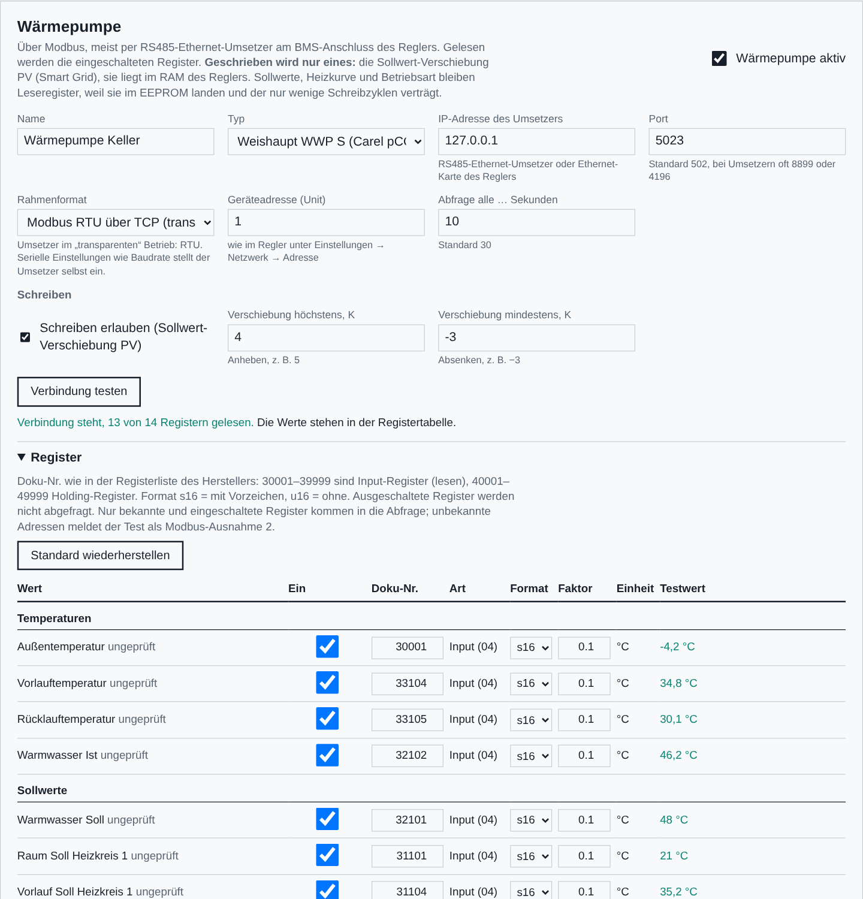
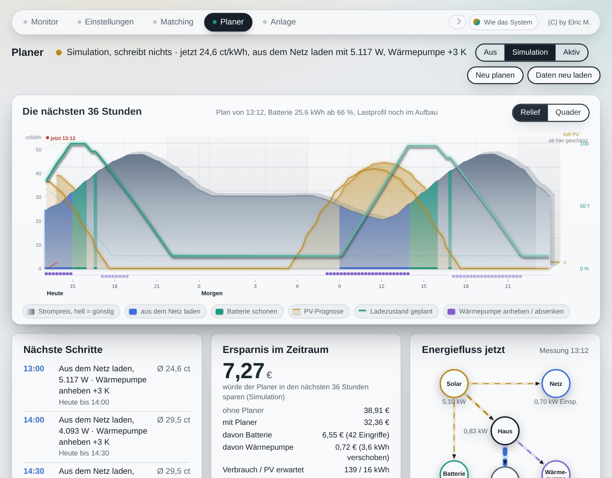

# Sungrow Steuerung – Handbuch

(C) by Elric M. · Nur private Nutzung zu Test- und Lernzwecken · Benutzung auf eigene Gefahr

---

## 1. Überblick

Die Sungrow Steuerung ist eine kleine Weboberfläche für Photovoltaikanlagen mit einem
Sungrow-Hybridwechselrichter der SH-RT-Reihe und einem Batterieturm (SBR). Sie spricht direkt mit den
Geräten im Heimnetz – per Modbus TCP und über die Weboberfläche des WiNet-S – und braucht weder Cloud
noch zusätzliche Software außer Node.js.

Sie besteht aus vier Seiten:

| Seite | Adresse | Zweck |
|---|---|---|
| Monitor | `/` | Leistungsfluss, Zellspannungen, Verlauf, Energie, Balancing-Protokoll |
| Einstellungen | `/einstellungen` | Einstellungen des Hybridwechselrichters lesen und schreiben |
| Matching | `/matching` | Assistent zum Angleichen eines neuen Batteriemoduls |
| Planer | `/planer` | Fahrplan für Batterie und Wärmepumpe nach Strompreis und Prognose |
| Anlage | `/anlage` | Einrichtung: Wechselrichter, Register, WiNet-S, Batterieturm, Wärmepumpe, Strompreis, Prognose, Planer (mit Passwort) |

> **Sicherheit.** Monitor, Einstellungen und Matching haben keinen Passwortschutz. Die Steuerung gehört
> ins eigene Heimnetz. Wer sie von unterwegs nutzen will, sollte ein VPN verwenden und sie nicht offen ins
> Internet stellen.

Die Installation beschreibt [INSTALL.md](INSTALL.md).

---

## 2. Seite Anlage – Einrichtung

### 2.1 Zugang

Beim ersten Aufruf legt man ein Passwort fest (mindestens 8 Zeichen). Gespeichert wird nur ein
scrypt-Hash in `config.json`. Die Anmeldung gilt 12 Stunden und übersteht einen Neustart. Nach fünf
Fehlversuchen sperrt die Seite für kurze Zeit. Unten auf der Seite lässt sich das Passwort ändern.

Solange kein Hybridwechselrichter eingetragen ist, läuft die Steuerung im **Einrichtungsmodus**: alle
anderen Seiten leiten auf `/anlage` um.

### 2.2 Anlage

- **Name der Anlage** – Überschrift im Monitor.
- **Port der Weboberfläche** – Standard 8787. Nach einer Änderung leitet die Seite selbst auf den neuen
  Port weiter.
- **Messintervall** – wie oft die Wechselrichter abgefragt werden, Standard 10 Sekunden.

### 2.3 Wechselrichter

Es gibt **genau einen aktiven Hybridwechselrichter**. Er liefert Batterie, Hausverbrauch und Netzbezug
und ist das Gerät, auf das Einstellungen und Matching schreiben. Dazu können **beliebig viele
Stringwechselrichter** kommen, deren Leistung im Monitor als „Solar gesamt“ mitgezählt wird.

Je Gerät:

| Feld | Bedeutung |
|---|---|
| Name | frei wählbar, erscheint im Monitor |
| Typ | Hybrid mit Batterie (SH-RT) oder Stringwechselrichter (SG-RT) |
| aktiv | ausgeschaltete Geräte bleiben gespeichert, werden aber nicht abgefragt |
| IP-Adresse oder Hostname | Adresse des WiNet-S bzw. des Wechselrichters |
| Modbus-Port | Standard 502 |
| Geräteadresse (Unit) | Standard 1 |
| Nennleistung (Hybrid) | Obergrenze aller Leistungsregler in Watt, z. B. 10600 bei einem 10-kW-Gerät |
| Hausverbrauch addieren (String) | nötig, wenn der Stringwechselrichter hinter dem Zähler des Hybrids einspeist und sein Ertrag sonst im Hausverbrauch fehlt |

**„Verbindung testen“** liest sofort alle eingetragenen Register und zeigt die Werte in der Tabelle –
ohne zu speichern. So sieht man vor dem Speichern, ob Adresse, Unit und Registerkarte stimmen.

### 2.4 Registeradressen

Unter **„Register“** klappt die Tabelle aller benutzten Register auf. Jede Zeile zeigt

- die **Adresse** (0-basiert, so wie sie im Modbus-Telegramm steht),
- die **Doku-Nr.** (Registernummer aus der Sungrow-Dokumentation = Adresse + 1),
- Funktionscode (FC03 Holding, FC04 Input), Datentyp, Einheit,
- nach einem Test den **gelesenen Wert**.

Die Adressen sind mit den Sungrow-Standardwerten vorbelegt. Weicht eine Firmware ab, trägt man die
richtige Adresse ein; „Standard wiederherstellen“ setzt sie zurück. Gespeichert werden nur die
Abweichungen. Die Steuerung fasst benachbarte Register beim Lesen zu Blöcken zusammen; kennt der
Wechselrichter einen Block nicht (Modbus-Ausnahme 2 oder 3), liest sie diesen Block danach einzeln.

Wichtige Standardadressen des Hybrids (Input-Register, FC04):

| Wert | Adresse | Typ |
|---|---|---|
| PV-Leistung | 5016 | u32, W |
| Hausverbrauch | 13007 | s32, W |
| Netzleistung (Einspeisung positiv) | 13009 | s32, W |
| Batteriespannung | 13019 | 0,1 V |
| Batteriestrom / -leistung | 13020 / 13021 | |
| Ladezustand (SoC) | 13022 | 0,1 % |
| Betriebszustand | 12999 / 13000 | |

Einstellungen (Holding-Register, FC03/FC06): Betriebsart 13049, Befehl 13050, Leistung 13051,
obere/untere Ladegrenze 13057/13058, Notstromreserve 13099, Einspeisebegrenzung 13086/13073,
größte Lade-/Entladeleistung 33046/33047, Zeitfenster 33207–33218.

Für Stringwechselrichter: AC-Leistung 5030 (u32), DC-Leistung 5016, Tagesertrag 5002, Gesamtertrag 5003.

> **Vorsicht.** Eine falsche Adresse bei den Holding-Registern bedeutet, dass beim Schreiben ein
> anderes Register verändert wird. Adressen der Einstellungen nur ändern, wenn die richtige Adresse
> sicher aus der Dokumentation der eigenen Firmware stammt.

### 2.5 Zellwerte

Die Spannungen der einzelnen Zellen kommen nicht über Modbus TCP des Hybrids, sondern über die
Weboberfläche des WiNet-S. Dafür braucht die Steuerung Benutzer und Passwort dieser Oberfläche.
Das Passwort wird nie an den Browser zurückgegeben; ein leeres Feld beim Speichern behält das gespeicherte.

Quellen:

- **WiNet-S** (empfohlen) – Anmeldung per WebSocket, Zellblock ab Register 10756.
- **Modbus** – für Anlagen, bei denen die Batterie selbst per Modbus erreichbar ist (eigene Unit, Standard 200). Adresse und Port sind frei wählbar, zum Beispiel ein Modbus-Proxy auf Port 5020; leer heißt: wie der Hybrid.
- **aus** – keine Zellwerte; der Monitor zeigt dann nur die Gesamtbatterie.

Der WiNet-S lässt nur **eine** Admin-Sitzung zu. Muss man selbst in die WiNet-Oberfläche, gibt der Knopf
**„WiNet-S freigeben“** im Monitor ihn für eine wählbare Zeit frei. Während eines Matching-Ablaufs ist
das gesperrt, weil der Ablauf die Zellwerte braucht.

### 2.6 Batterieturm

- **Anzahl Module** (1–8) und **Nummer des obersten Moduls** – bestimmt die Reihenfolge im Monitor.
- **Zielmodul** – das neue Modul, das der Matching-Assistent angleichen soll.
- **Notizen je Modul** – kurze Bemerkung, z. B. „neu“, erscheint im Monitor unter der Modulnummer.

### 2.7 Messgeräte

Leistungsmesser, die den Energiefluss ergänzen und dem Planer beim Lernen helfen. Jedes Messgerät liefert eine
Leistung in Watt und hat eine **Rolle**:

| Rolle | Wirkung |
|---|---|
| Haus | ersetzt im Energiefluss und im Lastprofil den aus dem Wechselrichter gerechneten Hausverbrauch |
| Wärmepumpe | geht in den Verlauf; daraus lernt der Planer die Heizlast je Grad Außentemperatur |
| E-Auto | eigener Knoten im Energiefluss; wird aus dem Lastprofil herausgerechnet, damit Ladevorgänge die Grundlast nicht verfälschen |
| Verbraucher | frei benannt, nur Anzeige unter dem Energiefluss |

Drei **Quellen** stehen zur Wahl:

- **Modbus** (TCP oder RTU über TCP): ein Register mit Format und Faktor. Vorlagen für Eastron SDM630, SDM120/230
  und SDM72 tragen Doku-Nr. 30013 bzw. 30053 und das Format f32 (Float, hohes Wort zuerst) ein. Für andere Geräte die
  Registerliste des Herstellers verwenden; „…le“-Formate tauschen die Wortfolge. Ein RS485-Bus hat nur einen Master:
  Zähler, die bereits an einer anderen Steuerung hängen, lassen sich nicht zusätzlich direkt abfragen.
- **Loxone Miniserver**: Die Steuerung fragt `http://<Miniserver>/jdev/sps/io/<Objektname>` mit Benutzer und
  Passwort ab. Der Objektname ist der Name des Modbus-Eingangs (oder eines Merkers) in Loxone Config; er muss
  eindeutig sein und sollte ohne Umlaute und Leerzeichen auskommen. Am besten einen eigenen Loxone-Benutzer mit
  reinem Leserecht anlegen. Die Loxone-Abfrage ist der richtige Weg, wenn die Zähler an der Modbus-Extension des
  Miniservers hängen.
- **HTTP / JSON**: beliebige Web-Schnittstelle (Shelly, Tasmota, Wallbox, eigene Dienste). Adresse und Pfad zum
  Wert, Felder mit Punkt getrennt, Listen mit Nummer: `emeters.0.power`. Optional Benutzer und Passwort.

„Wert lesen“ fragt das Gerät sofort ab. Faktor und „Vorzeichen umdrehen“ rechnen den Wert in Watt mit positivem
Verbrauch um. Passwörter werden nie an den Browser zurückgegeben; ein leeres Feld behält das gespeicherte.

### 2.8 Wärmepumpe

Die Steuerung liest eine Wärmepumpe über Modbus und kann ihr eine Sollwert-Verschiebung vorgeben. Vorbelegt ist die
Registerkarte einer **Weishaupt WWP S mit Carel-Regler pCO5+**; die Karte lässt sich Register für Register anpassen.

**Verbindung.** Der Carel-Regler hat einen RS485-Anschluss (BMS). Der einfachste Weg ins Netz ist ein kleiner
RS485-Ethernet-Umsetzer im „transparenten“ Betrieb: er reicht die Modbus-RTU-Telegramme unverändert über TCP durch.
Dafür steht das Rahmenformat auf **Modbus RTU über TCP**. Baudrate, Parität und Stoppbits stellt man am Umsetzer
genauso ein wie im Regler unter *Einstellungen → Netzwerk* (Protokoll Modbus RTU, Adresse, Baudrate, Parität,
Stoppbits). Hat der Regler eine Ethernet-Karte mit Modbus TCP, wählt man **Modbus TCP**.

**Register.** Jede Zeile der Tabelle hat eine Doku-Nr. in der klassischen Modbus-Schreibweise: 30001–39999 sind
Input-Register (nur lesen), 40001–49999 Holding-Register. Dazu Format (s16 mit Vorzeichen, u16 ohne), Faktor und
Einheit. Register lassen sich einzeln ein- und ausschalten; ausgeschaltete werden nicht abgefragt. „Verbindung
testen“ liest alle eingeschalteten Register sofort. Die mitgelieferten Adressen stammen aus einer Weishaupt-Liste und
sind als *ungeprüft* gekennzeichnet, bis sie an der eigenen Anlage stimmen.

**Schreiben – bewusst nur ein Register.** Geschrieben wird ausschließlich die **Sollwert-Verschiebung PV
(Smart Grid), Doku-Nr. 40002**. Sie liegt im RAM des Reglers und ist genau dafür vorgesehen, dass ein
Energiemanager den Sollwert vorübergehend anhebt oder absenkt. Alle anderen Holding-Register (Raumsoll,
Warmwassersoll, Heizkurve, Betriebsart) bleiben Leseregister: Sie landen im EEPROM des Reglers, der nur einige
zehntausend Schreibzyklen verträgt. Eine Steuerung, die alle paar Minuten nachregelt, würde ihn in wenigen Jahren
zerstören. Deshalb gibt es im Code eine feste Weißliste, die auch über die Seite Anlage nicht erweiterbar ist.

Damit die Verschiebung nie „hängen bleibt“: Beim Beenden der Steuerung, beim Umschalten des Planers auf Aus oder
Simulation und wenn Messwerte ausbleiben, schreibt die Steuerung 0 zurück. Die Grenzen (höchstens/mindestens)
auf der Seite Anlage gelten für jeden Schreibvorgang.

### 2.9 Strompreis

Für dynamische Tarife (Rabot Energy, Tibber, aWATTar und ähnliche) rechnet die Steuerung den eigenen Preis je
Viertelstunde selbst aus:

    Arbeitspreis = (Börsenpreis + feste Bestandteile netto) × (1 + MwSt)

Der Börsenpreis (EPEX Spot Day-Ahead) ist öffentlich und kommt wahlweise von **aWATTar** (stündlich) oder
**Energy-Charts** des Fraunhofer ISE (viertelstündlich); beide ohne Anmeldung. Die festen Bestandteile stehen auf der
Rechnung oder im Tarifblatt: Netzentgelt, Stromsteuer, Umlagen, Konzessionsabgabe und der Aufschlag des Anbieters,
alles netto in ct/kWh. Dazu die Einspeisevergütung, mit der der Planer eingespeisten Strom bewertet.

Die Preise des Folgetags erscheinen täglich gegen 13 Uhr; bis dahin schätzt der Planer sie aus dem Vortag (im
Zeitband heller dargestellt). Ohne Börse rechnet die Steuerung mit einem festen Preis. „Börse abfragen“ prüft die
Verbindung und zeigt den aktuellen Preis.

### 2.10 Prognose

Für den Planer braucht die Steuerung Wetter und PV-Ertrag der nächsten Tage. Eingetragen werden Standort
(Breiten- und Längengrad) und die Dachflächen mit Leistung, Ausrichtung (0 = Süd, −90 = Ost, 90 = West) und Neigung.

- **Open-Meteo** (Standard, ohne Limit): liefert Temperatur und Einstrahlung je Dachfläche; daraus rechnet die
  Steuerung den Ertrag (Leistung × Einstrahlung × Wirkungsgrad, temperaturkorrigiert).
- **forecast.solar**: liefert die PV-Prognose fertig (höchstens 12 Abrufe je Stunde, deshalb alle zwei Stunden).

Die Prognose **lernt**: Jeden Abend vergleicht die Steuerung den vorhergesagten mit dem gemessenen Tagesertrag
und führt einen Faktor (0,5 bis 1,6) nach. So fließen Verschattung und die tatsächliche Ausrichtung mit der Zeit ein.

### 2.11 Planer

Betriebsart (Aus, Simulation, Aktiv), die Grenzen der Batterie (Kapazität, untere und obere Ladegrenze, Lade- und
Entladeleistung, Wirkungsgrad, Mindestvorteil je kWh) und die Regeln für die Wärmepumpe. Einzelheiten in Kapitel 6.

### 2.12 Speichern

**„Speichern und neu starten“** prüft alle Eingaben, schreibt `config.json` (die vorige Fassung bleibt als
`config.json.bak`) und startet die Steuerung neu. Läuft sie unter systemd oder einem anderen Dienstverwalter
(`SUNGROW_SUPERVISED=1`), beendet sie sich und lässt sich von dort neu starten; sonst startet sie sich
selbst. Während eines Matching-Ablaufs ist Speichern gesperrt.

---

## 3. Monitor

**Skins.** Rechts im Menü jeder Seite lässt sich die Farbwelt wählen: *Wie das System* (hell oder dunkel nach
Betriebssystem), *Hell*, *Dunkel*, *Nacht* (tiefes Blau mit Neonakzenten) und *Sand* (warmes Papier). Die Wahl
wird im Browser gespeichert, jedes Gerät kann also seine eigene haben. Der Sonne/Mond-Knopf daneben schaltet
schnell zwischen Hell und Dunkel.

- **Kopfzeile** – Betriebszustand und Betriebsart, Zeit der letzten Messung, Knopf „WiNet-S freigeben“.
- **Batterieturm** – Ladezustand, Spannung, Strom, Leistung, Temperatur. Darunter jedes Modul mit
  niedrigster und höchster Zellspannung und seiner Spreizung. Unten die **Spreizung über alle Zellen**.
- **Leistungsfluss** – Solar gesamt (Hybrid plus alle aktiven Stringwechselrichter), Batterie, Netz, Haus.
- **Module im Vergleich** – Zellspannung je Modul und Abstand jedes Moduls zum Median des Turms.
- **Verlauf** – Leistung, Ladezustand und Spreizung der letzten Tage.
- **Energie** – Tageswerte für PV je Wechselrichter, Batterie, Netz und Eigenverbrauch.
- **Balancing-Protokoll** – je Tag die Spreizung bei vollem und bei leerem Speicher. So lässt sich über
  Wochen verfolgen, ob ein Modul aufholt.

---

## 4. Einstellungen

Die Seite liest die Einstellungen des Hybridwechselrichters und schreibt geänderte Werte zurück. Jede
Änderung wird vor dem Schreiben geprüft (Grenzen, Nennleistung), danach zurückgelesen und im Protokoll
festgehalten. Einstellungen mit größerer Wirkung (Betriebsart, Einspeisebegrenzung) verlangen eine
Bestätigung.

Kennzeichnung:

- **geprüft** – beim Entwickeln an einem SH-RT-Gerät geschrieben und das Verhalten beobachtet.
- **ungeprüft** – aus der Sungrow-Registerliste übernommen, nicht praktisch erprobt.

Gruppen: Betriebsart und Zwangsmodus · Lade- und Entladegrenzen · Leistungsgrenzen · Zwangsladung nach
Zeitfenster · Einspeisebegrenzung.

Hinweise oben auf der Seite weisen auf Einstellungen hin, die den Alltag stören oder einen Matching-Ablauf
verhindern würden, z. B. eine hohe untere Entladegrenze.

---

## 5. Matching-Assistent

### 5.1 Wozu

Wird ein neues Modul in einen bestehenden Turm gesetzt, hat es meist einen anderen Ladezustand als die
Bestandsmodule. Das Batteriemanagement gleicht nur passiv und langsam aus (es entlädt die jeweils
höchsten Zellen über Widerstände). Bis dahin begrenzt die schwächste Zelle die Entladung und die
stärkste die Ladung – nutzbare Kapazität geht verloren.

Der Assistent bringt neues Modul und Bestand **am unteren Ende** auf denselben Stand
(Bottom-Matching). Dort ist die LFP-Kennlinie steil, Unterschiede werden in Millivolt gut sichtbar.

### 5.2 Spannungslinienknick

Eine LFP-Zelle hat zwischen etwa 15 und 90 % Ladezustand ein sehr flaches Plateau: ein Millivolt
entspricht dort mehreren Prozent Ladung, Spannungsvergleiche sind kaum aussagekräftig. Unterhalb von
rund 10 % knickt die Kennlinie ab (das „Knie“, etwa 3,05–3,12 V Ruhespannung). Hier unterscheiden sich
Zellen mit unterschiedlichem Ladezustand um zig Millivolt – ein verlässlicher Vergleichspunkt.

Daraus folgt für den Alltag:

- Eine große Spreizung bei fast leerem Speicher ist normal und kein Defekt; aussagekräftig ist der
  Vergleich über mehrere Tage am gleichen Punkt der Kennlinie.
- Mitten im Plateau sagt eine kleine Spreizung wenig über den tatsächlichen Gleichstand.
- Module unterschiedlicher Kapazität (z. B. ein neues Modul mit etwas mehr Amperestunden) laufen am
  oberen und unteren Ende immer etwas auseinander, auch wenn sie perfekt angeglichen sind.

**Praxisbeispiel (anonym).** In einem Turm mit sieben älteren Modulen und einem neu eingesetzten lag die
Spreizung über alle Zellen bei leerem Speicher zunächst bei rund 250 mV, fast vollständig verursacht durch
das neue Modul. Nach dem Matching sank sie in wenigen Tagen deutlich; die Bestandsmodule lagen untereinander
bei 2–5 mV. Die verbleibenden Unterschiede am Knie erklärten sich zum größten Teil durch die etwas höhere
Kapazität des neuen Moduls, nicht durch einen Fehler.

### 5.3 Ablauf

1. **Grobentladung** mit allen Modulen bis kurz vor das Knie.
2. **Feinentladung** mit kleiner Leistung bis zum Knie des neuen Moduls.
3. **Ruhe und Referenzmessung** – die Spannung des neuen Moduls wird gemerkt.
4. **Neues Modul entnehmen** – Handgriff am Turm, Anlage nach Herstellervorgabe ausschalten.
   Die Steuerung wartet auf die Bestätigung.
5. **Grob- und Feinentladung** der Bestandsmodule bis zum Knie.
6. **Ruhe und Vergleich** mit der Referenz. Liegt die niedrigste Zelle nicht innerhalb von ±20 mV,
   folgen kurze Feinkorrekturen (laden oder entladen), jeweils mit Ruhepause.
7. **Neues Modul wieder einsetzen** – Handgriff, Bestätigung.
8. **Gemeinsam nachladen** bis etwa 40 %.
9. **Abschluss** – alle zuvor gemerkten Einstellungen werden zurückgeschrieben.

Während des Ablaufs schaltet die Steuerung den Wechselrichter in den Zwangsmodus und setzt Grenzen, die
eine tiefe Entladung verhindern würden, vorübergehend herab. Jeder Schritt hat ein Zeitlimit; bei
Auffälligkeiten hält der Ablauf an und wartet auf Entscheidung (fortsetzen oder abbrechen). Der Stand wird
in `data/ablauf.json` gesichert und übersteht einen Neustart.

> **Sicherheit.** Entnehmen und Einsetzen von Batteriemodulen nur nach den Vorgaben des Herstellers und
> nur, wenn man dafür qualifiziert ist. Der Ablauf geht bewusst bis in den unteren Ladebereich; die
> Untergrenze liegt bei 2,90 V je Zelle.

---

## 6. Planer

Der Planer macht aus Strompreis, PV-Prognose, Lastprofil und Heizlast einen **Fahrplan für die nächsten 36
Stunden** in Viertelstunden und führt ihn auf Wunsch aus.

### 6.1 Was er weiß

- **Strompreis** je Viertelstunde (Kapitel 2.9), für morgen ab etwa 13 Uhr, davor geschätzt.
- **PV-Prognose** und Außentemperatur (Kapitel 2.10).
- **Lastprofil des Hauses** aus dem eigenen Verlauf: der Verbrauch zur gleichen Uhrzeit an den letzten Tagen. Bis
  genug Verlauf da ist, gilt die Grundlast von der Seite Anlage.
- **Heizlast** der Wärmepumpe: Wird ihre elektrische Leistung gemessen (Register „Elektrische Leistung“), lernt die
  Steuerung aus dem Verlauf, wie viel Strom sie je Grad unter der Heizgrenze braucht. Sonst gilt die Annahme von der
  Seite Anlage, und die Wärmepumpe steckt in der Grundlast.

### 6.2 Wie er rechnet

1. **Ausgangslage Eigenverbrauch:** Die Batterie lädt aus PV-Überschuss und entlädt bei Bedarf. Das ergibt die
   Kosten ohne Planer.
2. **Bester Fahrplan:** Für jede Viertelstunde und jeden möglichen Ladezustand werden die Kosten bis zum Ende des
   Zeitraums berechnet (dynamische Programmierung). Daraus ergibt sich, wann es sich lohnt, **aus dem Netz zu laden**
   (billige Stunde vor teurer Stunde) und wann die Batterie **geschont** wird (in einer billigen Stunde nicht entladen,
   damit sie in einer teuren reicht). Verluste, Leistungsgrenzen und der Mindestvorteil je kWh sind eingerechnet.
   Energie, die am Ende übrig ist, wird vorsichtig mit dem billigsten Preis des Zeitraums bewertet.
3. **Wärmepumpe:** In den billigsten Viertelstunden oder bei PV-Überschuss mit voller Batterie wird der Sollwert
   angehoben (Wärme einlagern), in den teuersten abgesenkt, solange eingelagerte Wärme da ist. Wie lange Wärme
   vorhält, steht in „Wärme speichern, Stunden“.

Der Plan wird alle 15 Minuten neu gerechnet, außerdem sobald neue Preise oder eine neue Prognose eintreffen.

### 6.3 Ausblick

Der Planer rechnet standardmäßig 36 Stunden voraus (einstellbar bis 72). Preise, die die Börse noch nicht kennt,
schätzt er aus dem **Wochentagsmuster**: Mittel derselben Viertelstunde an denselben Wochentagen der letzten vier
Wochen, davor aus den letzten sieben Tagen. Geschätzte Abschnitte sind im Zeitband heller gezeichnet und mit „≈“
markiert; Eingriffe plant er dort nur, wenn sie auch bei unsicheren Preisen lohnen.

Die Kachel **Wochenausblick** zeigt sieben Tage: Solarertrag, erwarteter Verbrauch (Lastprofil plus Heizlast),
Temperatur, Heiztage und den mittleren Preis. Daraus lässt sich ablesen, ob ein Tag Überschuss bringt oder Strom aus
dem Netz braucht, etwa für die Frage, wann sich Warmwasser oder eine Autoladung lohnt.

### 6.4 Betriebsarten

| Betriebsart | Was passiert |
|---|---|
| Aus | nichts wird geplant |
| Simulation | Plan und Protokoll, es wird **nichts geschrieben**. Die Seite zeigt, was der Planer tun würde und was es sparen würde. |
| Aktiv | Der Planer setzt den Zwangsmodus des Wechselrichters (Laden aus dem Netz, Stopp zum Schonen, sonst Eigenverbrauch) und, wenn freigegeben, die Sollwert-Verschiebung der Wärmepumpe. |

Empfehlung: zwei Wochen Simulation, dann vergleichen, ob die Eingriffe sinnvoll aussehen, dann Aktiv.

Sicherheitsregeln im aktiven Modus:

- Während eines Matching-Ablaufs pausiert der Planer und rührt den Wechselrichter nicht an.
- Bleiben Messwerte länger als zwei Minuten aus, stellt er Eigenverbrauch wieder her und setzt die Verschiebung auf 0.
- Beim Beenden der Steuerung (auch beim Neustart nach dem Speichern) werden Eigenverbrauch und Verschiebung 0 gesetzt.
- Geschrieben wird nur bei einer Änderung des Sollzustands, nicht zyklisch. Jeder Schreibvorgang steht im
  Änderungsprotokoll auf der Seite Einstellungen.

### 6.5 Die Seite

Das **Zeitband** ist als Raum gezeichnet, die PV-Prognose liegt an der Rückwand, die geplante Ladezustandslinie
schwebt davor, Tiefenlinien auf dem Boden markieren die Stunden. Für den Preis gibt es zwei Darstellungen, rechts
oben umschaltbar und je Browser gemerkt: **Relief** (eine weiche Landschaft, hell = günstig, dunkel = teuer, mit den
Eingriffen als Farbzonen) und **Quader** (feine Balken je Viertelstunde mit derselben Preisschattierung).
Die Farben sind fest zugeordnet: Blau für Netz und Netzladen, Teal für die Batterie, Amber für Solar, Violett für
Wärme.
Die Kachel **Energiefluss jetzt** zeigt die Messwerte als Knoten (Solar, Netz, Batterie, Haus, Wärmepumpe,
E-Auto) mit laufenden Linien in Richtung des Stromflusses; die Dicke entspricht der Leistung. Haus, Wärmepumpe
und E-Auto nehmen die Werte der Messgeräte (Kapitel 2.7), sofern eingerichtet; das E-Auto bleibt sonst ausgegraut.

Das **Zeitband** zeigt je Viertelstunde den Preis als Balken (blau: aus dem Netz laden, schraffiert: Batterie
schonen, grau: Eigenverbrauch), die PV-Prognose als Fläche, den geplanten Ladezustand als Linie (gestrichelt: ohne
Planer) und darunter die Eingriffe an der Wärmepumpe. Die rote Linie ist „jetzt“. Mit der Maus über dem Band
erscheinen die Zahlen der Viertelstunde.

Darunter die **nächsten Schritte**, die **Ersparnis** im Zeitraum (ohne Planer / mit Planer, getrennt nach Batterie
und Wärmepumpe), der Zustand der **Wärmepumpe**, die **Datenquellen** und das **Protokoll**. Die Betriebsart lässt
sich oben direkt umschalten; „Aktiv“ fragt vorher nach.

---

## 7. Werkzeuge für die Konsole

Alle Werkzeuge lesen Adresse, Port, Geräteadresse und abweichende Registeradressen aus `config.json`.

| Aufruf | Zweck |
|---|---|
| `node check.js [IP]` | liest alles, was eine Entladung verhindern kann; schreibt nichts |
| `node ems.js status` | zeigt Betriebsart und Zwangsmodus |
| `node ems.js laden 3000` / `entladen 3000` / `ruhe` / `normal` | Zwangsmodus von Hand – **schreibt** |
| `node modbus.js lesen 4 13019 6` | beliebige Register lesen (FC03 oder FC04) |
| `node modbus.js schreiben 13058 50` | ein Holding-Register schreiben, mit Rückfrage |

`modbus.js` kennt die Zusätze `--host`, `--port`, `--unit` und `--ja` (ohne Rückfrage).

---

## 8. Schnittstellen (für eigene Auswertungen)

| Endpunkt | Inhalt |
|---|---|
| `GET /api/live` | aktuelle Messwerte, Zellen, Stringwechselrichter, Fehlerzustand |
| `GET /api/history` | Verlauf |
| `GET /api/balancing` | Balancing-Protokoll je Tag |
| `GET /api/settings` | Einstellungen des Hybrids (`?force=1` liest neu) |
| `GET /api/state` | Stand des Matching-Ablaufs |
| `POST /api/winet-pause` | WiNet-S freigeben, `{ "minutes": 30 }`, `0` beendet die Freigabe |
| `GET /api/planer` | Fahrplan, Preise, Prognose, Wärmepumpe, Protokoll |
| `POST /api/planer` | `{ "action": "mode", "mode": "off\|simulate\|active" }`, `{ "action": "replan" }`, `{ "action": "refresh" }` |
| `/api/setup/*` | Seite Anlage, nur nach Anmeldung |

Jede Antwort trägt die Kopfzeile `X-Build` mit der Kennung des Programmstands.

---

## 9. Dateien

| Datei | Zweck |
|---|---|
| `server.js` | Hauptprogramm: Abfrage, Speicherung, Weboberfläche |
| `registers.js` | Registerkarten für Hybrid und String, Lesepläne |
| `control.js` | Einstellungen und Matching-Ablauf |
| `setup.js` | Seite Anlage: Anmeldung, Prüfung, Speichern |
| `modbus-client.js` | Modbus TCP und RTU über TCP |
| `heatpump.js` | Wärmepumpe: Registerkarte, Lesen, Weißliste fürs Schreiben |
| `meters.js` | Messgeräte: Modbus, Loxone, HTTP/JSON |
| `prices.js`, `forecast.js`, `web.js` | Strompreis, Wetter und PV-Prognose |
| `planner.js` | Fahrplan für Batterie und Wärmepumpe |
| `check.js`, `ems.js`, `modbus.js` | Konsolenwerkzeuge |
| `start.sh`, `stop.sh`, `watchdog.sh`, `install-dienst.sh` | Betrieb auf NAS und Linux |
| `public/` | Weboberfläche |
| `config.json` | persönliche Einstellungen – entsteht beim ersten Speichern, **nicht weitergeben** |
| `data/` | Verlauf, Protokolle, Ablaufstand – **nicht weitergeben** |

---

## 10. Fehlersuche

| Meldung | Ursache und Abhilfe |
|---|---|
| Wechselrichter antwortet nicht | IP-Adresse, Port 502, Modbus TCP am WiNet-S aktiv? Kein zweites Programm, das dauerhaft per Modbus abfragt? |
| Modbus-Ausnahme 2 | Registeradresse unbekannt – auf der Seite Anlage die Adresse prüfen (Doku-Nr. minus 1). |
| WiNet-S: Anmeldung abgelehnt | Benutzer/Passwort der WiNet-Weboberfläche prüfen; ist gerade jemand anderes angemeldet? |
| Zellwerte fehlen zeitweise | WiNet-S war freigegeben oder eine andere Sitzung hat ihn übernommen. |
| Seiten leiten auf /anlage um | Einrichtungsmodus: noch kein aktiver Hybridwechselrichter gespeichert. |
| Port schon belegt | Läuft die Steuerung bereits? Sonst anderen Port auf der Seite Anlage wählen. |
| Wärmepumpe: Zeitüberschreitung | Umsetzer erreichbar? Rahmenformat (RTU über TCP oder Modbus TCP), Baudrate und Geräteadresse am Umsetzer und im Regler gleich? |
| Wärmepumpe: CRC-Fehler | Rahmenformat falsch oder der Umsetzer hängt Steuerzeichen an. Auf Modbus TCP umstellen, falls der Umsetzer ein Gateway ist. |
| Strompreise: Name nicht auflösbar | Der Rechner hat kein Internet oder DNS. Ohne Börse gilt der Ersatzpreis. |
| Prognose: Standort fehlt | Breiten- und Längengrad auf der Seite Anlage eintragen. |

Das Protokoll steht in `data/steuerung.log` (bzw. im Journal von systemd).

---

## 11. Unterstützen – für Maja

Ich möchte kein Geld für die Software haben. Aber eine liebe Bitte an Euch: Ein kleines Mädel und ihre Familie
würden sich freuen, wenn man ihnen hilft. Eine Spende – egal in welcher Höhe – wäre eine wunderschöne Tat.

**[Für Maja – jeder Schritt zurück ins Leben zählt](https://www.gofundme.com/f/fur-maja-jeder-schritt-zuruck-ins-leben-zahlt)** (GoFundMe)

Schreibt bitte beim Namen gerne den eigenen Namen & Elric oder als Name einfach „Elric“.
Ganz lieben Dank!

---

## 12. Lizenz und Haftung

Nur private, nicht gewerbliche Nutzung zu Test- und Lernzwecken. Kommerzielle Verwendung, Verwendung im
Geschäftsbetrieb und Weiterverkauf sind untersagt. Benutzung auf eigene Gefahr, ohne Gewährleistung oder
Garantie. Vollständiger Text: [LICENSE](LICENSE).

Sungrow und WiNet sind Marken ihrer Inhaber. Dieses Projekt steht in keiner Verbindung zu Sungrow.

(C) by Elric M.
