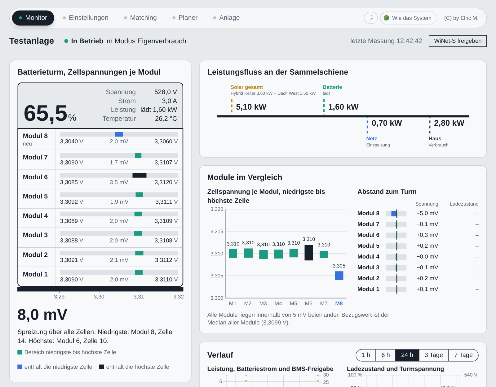

<p align="center"></p>

<h1 align="center">Sungrow Steuerung</h1>

<p align="center">Monitor, Einstellungen und Matching-Assistent für Sungrow-Hybridwechselrichter (SH-RT) mit Batterieturm (SBR)<br>
über Modbus TCP und den WiNet-S – ohne Cloud, ohne zusätzliche Pakete, nur Node.js.</p>

<p align="center"><b>Private Nutzung zu Test- und Lernzwecken. Benutzung auf eigene Gefahr.</b> Siehe <a href="LICENSE">LICENSE</a>.</p>

---



## Was die Software kann

- **Monitor** – Leistungsfluss (Solar, Batterie, Netz, Haus), Zellspannungen aller Module des Batterieturms,
  Spreizung, Verlauf, Tagesenergien und ein Balancing-Protokoll.
- **Mehrere Wechselrichter** – genau ein Hybridwechselrichter mit Batterie, dazu beliebig viele
  Stringwechselrichter (SG-RT). Namen frei wählbar, jeder lässt sich einzeln ein- und ausschalten.
- **Frei wählbare Register** – alle Modbus-Adressen sind mit den Sungrow-Standardwerten vorbelegt und
  lassen sich je Gerät ändern, mit Sofort-Test direkt auf der Seite.
- **Einstellungen** – Betriebsart, Lade- und Entladegrenzen, Leistungsgrenzen, Zeitfenster für
  Zwangsladung und Einspeisebegrenzung lesen und schreiben, mit Zurücklesen und Protokoll.
- **Matching-Assistent** – führt Schritt für Schritt durch das Angleichen eines neuen Batteriemoduls
  an die Bestandsmodule (Bottom-Matching über den Spannungsknick der LFP-Kennlinie).
- **Planer** – holt den Börsenstrompreis (für dynamische Tarife wie Rabot Energy, Tibber, aWATTar), Wetter und
  PV-Prognose und rechnet daraus den günstigsten Fahrplan: wann die Batterie aus dem Netz lädt, wann sie geschont
  wird, wann die Wärmepumpe Wärme einlagert. Erst Simulation, dann auf Wunsch aktiv.
- **Wärmepumpe** – Anbindung über Modbus (RTU über TCP oder Modbus TCP), vorbelegt für Weishaupt WWP S mit
  Carel pCO5+. Geschrieben wird ausschließlich die Sollwert-Verschiebung PV (RAM), nie ein EEPROM-Register.
- **Messgeräte** – Eastron SDM630 und andere Zähler per Modbus, über einen Loxone Miniserver oder jede
  JSON-Schnittstelle; mit Rollen für Haus, Wärmepumpe und E-Auto im Energiefluss.
- **Seite Anlage** – die komplette Einrichtung im Browser, geschützt durch ein eigenes Passwort.
  Eine `config.json` muss niemand von Hand schreiben.

## Schnellstart

```sh
node server.js
```

Dann im Browser `http://<Rechner>:8787/anlage` öffnen, ein Passwort festlegen, Wechselrichter eintragen,
„Verbindung testen“, speichern. Ausführlich: **[INSTALL.md](INSTALL.md)** und **[HANDBUCH.md](HANDBUCH.md)**
(auch als PDF).

## Docker

```sh
docker run -d --name sungrow-steuerung --restart unless-stopped -p 8787:8787 -v $PWD/daten:/data ghcr.io/DEIN-GITHUB-NAME/sungrow-steuerung:latest
```

Konfiguration und Daten liegen im Volume `/data`. Eine `docker-compose.yml` liegt bei. Das Image wird bei jedem Push
automatisch gebaut (`.github/workflows/docker.yml`) und in der GitHub Container Registry abgelegt.

## Voraussetzungen

- Node.js 18 oder neuer (getestet mit 22), keine weiteren Pakete
- Sungrow-Hybridwechselrichter der SH-RT-Reihe mit WiNet-S, Modbus TCP im lokalen Netz erreichbar
- für die Zellspannungen: Zugang zur Weboberfläche des WiNet-S (Benutzer und Passwort)
- für den Planer: Internetzugang des Rechners (Börsenpreise, Wetter), optional ein RS485-Ethernet-Umsetzer für die Wärmepumpe

## Unterstützen – für Maja ❤️

Ich möchte kein Geld für die Software haben. Aber eine liebe Bitte an Euch: Ein kleines Mädel und ihre Familie
würden sich freuen, wenn man ihnen hilft. Eine Spende – egal in welcher Höhe – wäre eine wunderschöne Tat.

👉 **[Für Maja – jeder Schritt zurück ins Leben zählt](https://www.gofundme.com/f/fur-maja-jeder-schritt-zuruck-ins-leben-zahlt)** (GoFundMe)

Schreibt bitte beim Namen gerne den eigenen Namen & Elric oder als Name einfach „Elric“.
Ganz lieben Dank!

## Wichtig

Die Software **schreibt** auf Wunsch Einstellungen in den Wechselrichter und kann Lade- und
Entladevorgänge auslösen. Die Seiten Monitor, Einstellungen und Matching haben keinen eigenen
Passwortschutz – betreibe die Steuerung nur im eigenen Heimnetz und gib sie nicht ungeschützt ins Internet frei.

Sungrow und WiNet sind Marken ihrer Inhaber. Dieses private Projekt steht in keiner Verbindung zu Sungrow.

(C) by Elric M.
